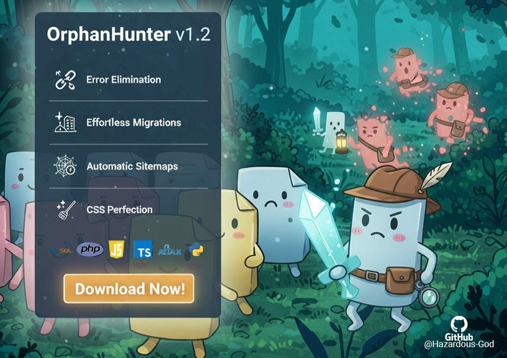

<div align="center">
  

  # OrphanHunter v1.3

  **Crawl web application codebases — map variables, tables, and references — then surface orphans, broken links, and migration issues.**

  [](LICENSE)
  [](https://www.python.org/downloads/)
  [](CHANGELOG.md)
  [](https://github.com/GatoGodMode)

</div>

---

## What is OrphanHunter?

OrphanHunter is a **desktop crawl-and-audit tool** for PHP/SQL/JS web applications. It walks your project tree, parses source and database content, and builds a cross-reference map of **files, URLs, CSS selectors, config variables, and SQL tables** — then flags what is unused, conflicting, or broken.

Built for legacy cleanup, pre-migration hardening, and ongoing codebase hygiene.

**Created by:** [Joseph Edwards (@GatoGodMode)](https://github.com/GatoGodMode) · MIT licensed

---

## Core capabilities

| Capability | What it does |
|---|---|
| **Project crawl** | Scan PHP, HTML, JS/TS, CSS, JSON, and SQL dumps across a root directory |
| **Reference tracking** | Line-level maps of includes, hrefs, imports, fetch calls, and form actions |
| **SQL tables & content** | Parse dumps or connect live to MySQL — extract tables, columns, and file/URL references in stored content |
| **Config variables** | Read `config.php` patterns (DB host, base URLs, constants) or set credentials in the UI |
| **Orphan detection** | Find files never referenced by navigation, includes, DB content, or JS imports |
| **CSS analysis** | Duplicate selectors, overlapping rules, unused styles, per-page usage |
| **URL migration** | 7-step workflow: detect hardcoded URLs → classify internal vs external → backup → convert to `BASE_URL` / helpers → rollback |
| **Dependency graph** | Visual map of how files reference each other |
| **Safe deletion** | Backup-first orphan removal with sanity checks and rollback |
| **Documentation export** | Markdown reports, system tree maps, `sitemap.xml` generation |

---

## Quick start

**Requirements:** Python 3.7+ · Windows, macOS, or Linux

```bash
git clone https://github.com/GatoGodMode/OrphanHunter.git
cd OrphanHunter
python OrphanHunter.py
```

First launch auto-detects missing dependencies (`PyQt5`, `lxml`, `chardet`, `packaging`) and offers to install them.

**Typical workflow**

1. Set project root and optional `config.php` path
2. Configure SQL — parse a dump **or** connect live via the SQL credentials dialog (v1.3)
3. **Start Scan** — crawl files, tables, and cross-references
4. Review orphans, CSS conflicts, and broken references
5. Use **URL Migration Tool** (Generate Docs tab) before domain moves
6. Delete with backup, or export documentation

OrphanHunter v1.3 can migrate itself into a `.ORPHANHUNTER` folder inside your project so reports and backups stay organized.

---

## URL migration example

**Before:**
```php
$url = "https://dev.example.com/api/users.php";
header("Location: https://dev.example.com/dashboard.php");
```

**After (`BASE_URL` pattern):**
```php
$url = BASE_URL . '/api/users.php';
header("Location: " . BASE_URL . '/dashboard.php');
```

External URLs (CDN, third-party APIs) are preserved. Full backup and selective rollback included.

---

## Architecture

| Layer | Stack |
|---|---|
| Runtime | Python 3.7+ |
| GUI | PyQt5 desktop app |
| Parsers | Custom PHP / SQL / JS / CSS analyzers + `lxml` |
| Database | MySQL live connector (optional) or SQL dump parser |
| Safety | Multi-step approval, ZIP backups, audit logging |

**Supported extensions:** `.php`, `.html`, `.js`, `.ts`, `.css`, `.sql`, `.json`

---

## Project layout

```
OrphanHunter.py              # Entry point (portable bootstrap + GUI launch)
OrphanHunter/
  analyzer/                    # Crawlers: php_parser, sql_parser, css_analyzer,
                               #   reference_tracker, live_db_connector, dependency_graph
  scanner/                     # file_scanner
  operations/                  # backup, deletion, migration, sanity_checker, url_migrator
  generators/                  # markdown + sitemap output
  gui/                         # PyQt5 main window, SQL dialog, URL migration UI
EnVars/                        # SysMap + VarMap (structure / constants)
CHANGELOG.md
```

---

## Documentation

- **[CHANGELOG.md](CHANGELOG.md)** — v1.3 self-migration, SQL credentials UI, GitHub version check; v1.2 URL migration

---

## Contributing

Issues and PRs welcome at [github.com/GatoGodMode/OrphanHunter](https://github.com/GatoGodMode/OrphanHunter).

---

## License

MIT — see [LICENSE](LICENSE). Free for commercial and private use.

---

**Related:** [GatoGodMode profile](https://github.com/GatoGodMode) · [CollectorBuyerPsych](https://github.com/GatoGodMode/CollectorBuyerPsych) · [RoofRoofTexas-Rebuild](https://github.com/GatoGodMode/RoofRoofTexas-Rebuild)
